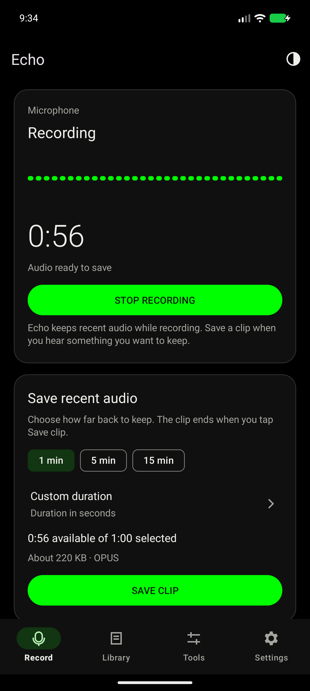
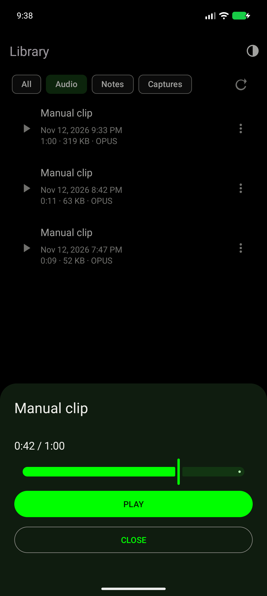
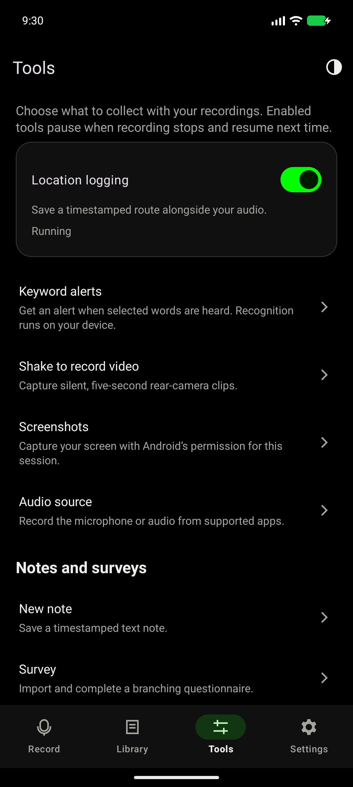
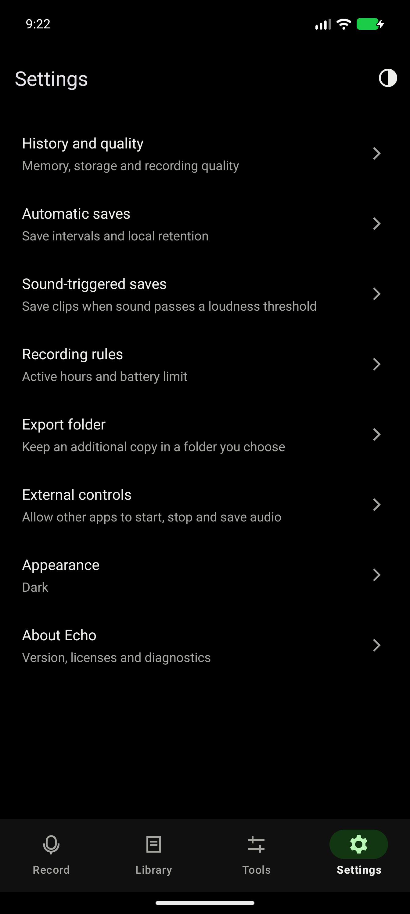
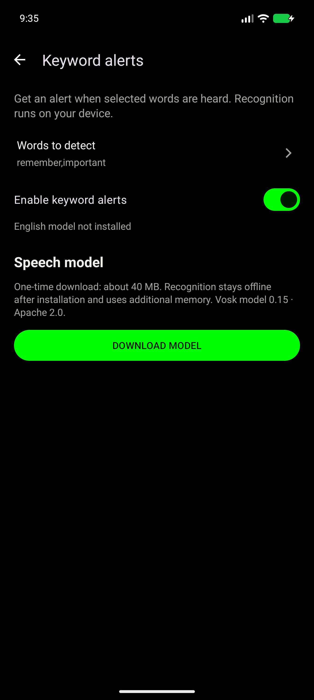
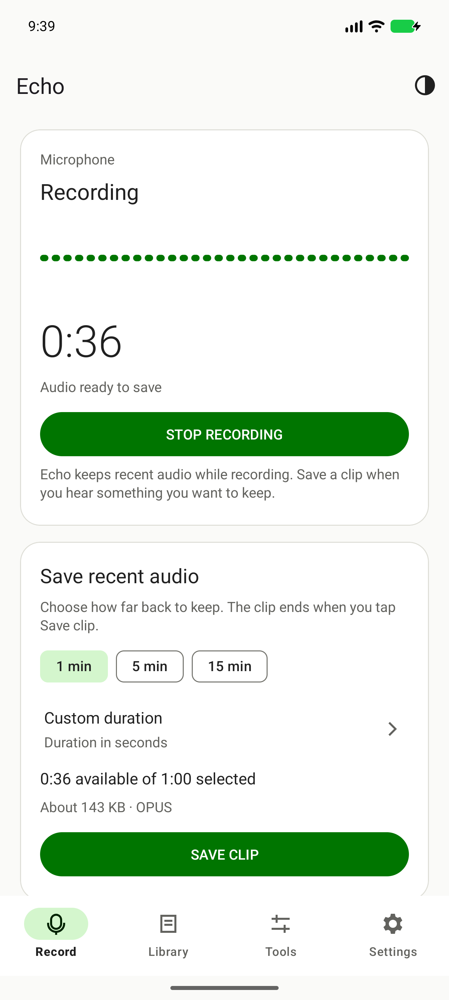

# Echo

Save audio from the past. This fork consolidates the recorder and useful additions from the Echo fork network into one Android app.

Android 11 or newer. Application ID: `com.klob.echo`, so it can coexist with original Echo. Current release: [2.2.0](https://github.com/xklob/echo/releases/tag/v2.2.0), versionCode `19`.

## Screenshots

Echo 2.2.0 on an Android 17 emulator, using generated test recordings. System, Light and Dark themes are available; System is the default.

<p>
  
  
  
  
  
  
</p>

## Roadmap

- [x] A comprehensive UI/UX overhaul, delivered in 2.2.0.
- [ ] Wearable integration, such as recording from a watch.
- [ ] A web dashboard and control panel.
- [ ] Semantic search through recordings.

These are separate from unfinished source integration. See the [custom-feature backlog](docs/custom-feature-backlog.md).

## Use

Open **Record**, tap **START RECORDING**, allow microphone access, then choose how far back to keep and tap **SAVE CLIP**. **STOP RECORDING** stays stopped. After a reboot or process recreation, open Echo and tap **RESUME RECORDING**; Android does not permit unrestricted microphone startup from a boot receiver.

Use **Library** to play, share, rename and delete saved items, **Tools** for optional capture and notes, and **Settings** for recording preferences. Bottom navigation becomes a side rail in wider windows.

Settings control history budgets, quality, format, automatic saves and listening rules. Each switch saves immediately; value dialogs validate before saving. There is no global Apply button. Changes are saved while recording; history, quality and activity changes take effect when recording next starts. Invalid values are highlighted instead of silently ignored. Equal start/end hours mean all day; overnight windows are supported. Android can delay schedule transitions when exact-alarm access is unavailable.

Saved files stay in private app storage. Share recordings before uninstalling. An optional folder picker creates verified additional copies; library rename/delete affects local files. Folder copies remain independent and do not follow automatic local retention. Revoked grants and provider errors are reported while the local recording is kept. No all-files permission is requested.

Automatic retention applies separately to automatic, continuous and activity clips. Manual clips remain until deleted. A continuous segment uses the configured autosave interval; stopping flushes its remaining tail. Only one export runs at once.

History is compressed before saving. WAV and FLAC decode that Opus history; they cannot restore discarded quality. Opus preserves compressed packets without re-encoding. AAC can include encoder priming/padding; the clip JSON records captured duration separately. Approximate file sizes are labelled as estimates.

Microphone interruptions freeze usable history. Recovery starts a new history and reports the reset, so files do not pretend gaps were captured. Switching audio source, history storage or quality also starts new history. Saved clips remain.

## Optional tools

Tools are off until explicitly enabled. Location, camera and keyword-alert choices persist across recording sessions. Stopping recording pauses their operation without clearing those choices. Camera, location and screen capture request their permissions or native Android consent separately. Capture state remains visible in the foreground notification.

- Activity saves detect loudness, including non-speech. Threshold and pre/post-roll are configurable. Ordinary quiet audio remains saveable.
- Keyword recognition uses the same captured samples. Install the optional US-English Vosk model from **Tools → Keyword alerts**; recognition stays offline after installation. The approximately 40 MB download and substantial native model RAM are additional to the history budget. Both library and supplied model use Apache-2.0.
- GPS writes timestamped GPX traces. Audio sample times and GPS fixes share wall-clock associations, not sample-perfect synchronization.
- Shake capture uses four swings followed by a return to the prior level of motion. The current configuration records silent five-second rear-camera clips. A capture-now button is also available. Camera/microphone concurrency depends on the device.
- Screenshots require native screen-capture consent and stop with that consent/session. Device-audio capture needs a separate consent session and works only with permitted playback usages/apps. It cannot run alongside screenshots in this build. Microphone/device source changes explicitly reset history.
- Notes and imported branching surveys are saved as separate traces. See [survey format](docs/survey-format.md).
- Server sync is opt-in; its token is protected by Android Keystore. See [server](server/README.md). No upload occurs with default settings.

Simultaneous microphone + device-audio synchronization and automatic multi-quality history remain blocked source experiments. No placeholder controls are shipped. See the [integration ledger](docs/integration-ledger.md).

## Build and validation

Install ffmpeg for the independent export tests. JDK 17, Gradle 9.6.0, Android Gradle Plugin 9.5.0, compile/target API 37. Build Tools 36.0.0. Install SDK `platforms;android-37.0` and accept its license, then set `ANDROID_HOME` or an untracked `local.properties`.

```sh
./gradlew testDebugUnitTest lintDebug assembleDebug assembleDebugAndroidTest
./gradlew connectedDebugAndroidTest
```

Debug APK: `app/build/outputs/apk/debug/app-debug.apk`. Debug and release builds use different certificates. Export any wanted data from an earlier development build before replacing it with the production app; Android will reject an in-place update across those certificates. Future production updates retain the dedicated release certificate and increase versionCode.

For a signed minified release, set `ECHO_SIGNING_PROPERTIES` to a private properties file containing `storeFile`, `storePassword`, `keyAlias`, and `keyPassword`. Resolve the keystore path relative to that file. Keep the key and credentials outside Git:

```sh
ECHO_SIGNING_PROPERTIES=/private/path/signing.properties ./gradlew assembleRelease lintRelease
```

Without signing configuration, release builds remain unsigned. Klobstore tracks the standalone signed APK from GitHub Releases.

See [testing](docs/testing.md), [architecture](docs/architecture.md), [automation](docs/automation.md), [changelog](CHANGELOG.md), and the separate [custom-feature backlog](docs/custom-feature-backlog.md). Device coverage and physical-device gaps are recorded in testing, rather than inferred from a successful build.

## Attribution

Fork of [mafik/echo](https://github.com/mafik/echo), preserving upstream history and [GPL-3.0](LICENSE.txt). Adapted work and dependencies are listed in [third-party notices](docs/third-party-notices.md) and the source ledger. Contributor repositories are read-only integration sources.
